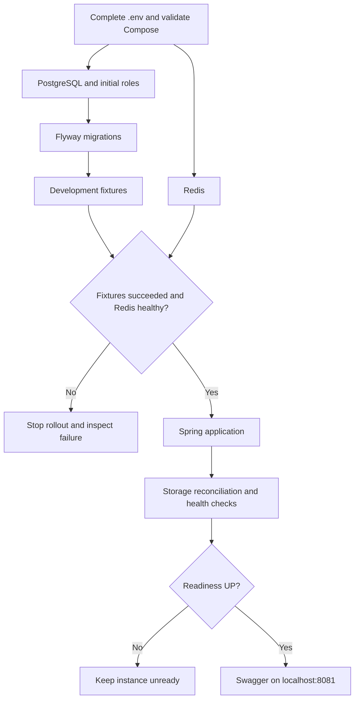

# Auto-Parto

## Local startup overview

See the [local PostgreSQL migration guide](docs/postgresql-development-cutover.md) for configuration and startup commands.

## Project workflow diagrams

See the [complete Mermaid workflow catalogue](docs/workflows.md) for individual diagrams and implementation/runbook references.

| Area | Workflows |
| --- | --- |
| Identity and access | [HTTP authorization/errors](docs/workflows.md#http-authentication-authorization-and-safe-errors), [OTP login](docs/workflows.md#otp-onboarding-and-login), [rate limiting](docs/workflows.md#redis-authentication-rate-limiting), [JWT rotation](docs/workflows.md#jwt-signing-and-key-rotation), [profiles/deactivation](docs/workflows.md#profile-updates-and-account-deactivation) |
| Marketplace and money | [Part requests](docs/workflows.md#buyer-part-request-lifecycle), [listings](docs/workflows.md#seller-listing-lifecycle), [matching](docs/workflows.md#marketplace-matching), [offers](docs/workflows.md#offer-creation-and-decisions), [wallet ledger](docs/workflows.md#wallet-credit-debit-and-idempotency) |
| Files and notifications | [Uploads](docs/workflows.md#file-upload-and-compensation), [downloads](docs/workflows.md#file-download), [reconciliation](docs/workflows.md#storage-reconciliation-and-recovery), [device tokens](docs/workflows.md#device-token-registration-invalidation-and-rebuild), [preferences](docs/workflows.md#notification-preferences), [durable notifications](docs/workflows.md#durable-notification-creation-and-sse-attempts), [SSE replay](docs/workflows.md#sse-connection-replay-and-cleanup), [FCM](docs/workflows.md#fcm-provider-delivery), [audit](docs/workflows.md#audit-outbox-delivery) |
| Development and operations | [Startup](docs/workflows.md#local-startup-and-readiness), [Swagger](docs/workflows.md#current-swagger-generation-and-browsing), [provider isolation](docs/workflows.md#provider-isolation-and-cancellation), [observability](docs/workflows.md#observability-and-incident-diagnosis), [CI](docs/workflows.md#github-continuous-integration), [secrets](docs/workflows.md#production-secret-delivery-and-activation), [release gate](docs/workflows.md#protected-migration-and-release-gate), [edge validation](docs/workflows.md#production-edge-and-sse-release-validation), [recovery](docs/workflows.md#backup-restore-and-projection-recovery) |
| Agent collaboration | [Delivery/review](docs/workflows.md#agent-feature-delivery-and-publication), [proposals](docs/workflows.md#creative-proposals-and-human-approval), [handover](docs/workflows.md#context-handover-and-task-recovery) |

The catalogue separates implemented behavior from operator procedures and planned deployment gates. Durable SSE delivery and direct FCM provider calls have separate diagrams; they are not an implied automatic fallback chain.

## PostgreSQL development migration

PostgreSQL is the application persistence boundary. To run the schema and fixtures locally, follow [`docs/postgresql-development-cutover.md`](docs/postgresql-development-cutover.md). The Compose profile provisions distinct runtime and migration roles, runs Flyway as a one-shot job, and provides idempotent development fixtures.

Authentication currently uses the OTP-to-JWT canonical model documented in [`docs/canonical-authentication.md`](docs/canonical-authentication.md). Incomplete Google and Clerk integrations remain disabled.

The canonical versioned HTTP API and legacy-route migration policy are documented in [`docs/api-boundaries.md`](docs/api-boundaries.md).

## Agent collaboration

Codex feature delivery uses Coder, Reviewer and DevOps with independent commit approvals and a GitHub PR handoff for human review. Read [the agent workflow](docs/agent-workflow.md). Open Codex in this repository to load `.codex/config.toml` and `.codex/agents/`; model settings inherit from the current chat. Local progress is recorded in ignored `handover.md` using [the versioned template](docs/agent-handover-template.md).

Coder can also suggest evidence-based product, technical and workflow improvements through [feature proposals](docs/feature-proposals/README.md). Reviewer and DevOps assess each proposal; implementation requires your explicit approval.
