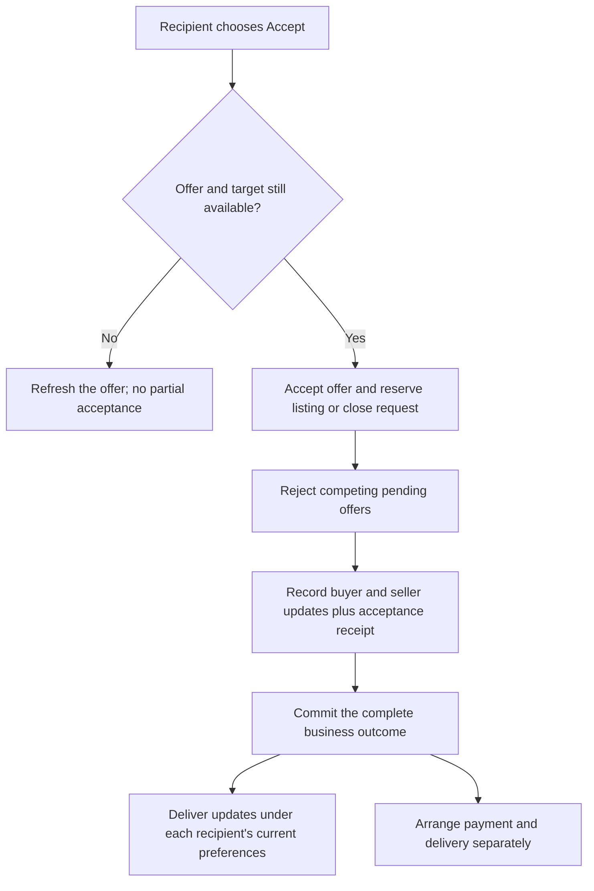

# Offer decisions and acceptance recovery

Use `POST /api/v1/offers/requests/{requestId}` as a seller, or `POST /api/v1/offers/listings/{listingId}` as a buyer. Participants are derived from the authenticated caller and persisted target ownership. New offers require an OPEN request or PUBLISHED listing. `/offers/**` aliases use the same rules.

Use `GET /api/v1/offers/{offerId}` to obtain the public IDs, current status and `version`. Submit `PATCH /api/v1/offers/{offerId}/status` with `status` and `expectedVersion`. Unrelated callers and creators deciding their own offers receive 403; no administrator override exists. Missing resources are 404, invalid input is 400 and stale/unavailable/terminal decisions are 409.

| Origin | Accept/reject | Cancel while pending | Acceptance outcome |
| --- | --- | --- | --- |
| Seller offer on buyer request | Buyer recipient | Either participant | Close request |
| Buyer offer on seller listing | Seller recipient | Either participant | Reserve listing |

Acceptance rejects competing PENDING offers for that same target. One PostgreSQL transaction locks the target before the offer, verifies current availability/participants/version, changes offer and target states, rejects competitors, enqueues exactly two logical OFFER_ACCEPTED notifications with their outbox events, and stores an immutable acceptance receipt. Creation uses the same target lock, so it cannot add an eligible offer after acceptance. Concurrent manual target transitions use the existing row/version guards. Partial unique indexes also prevent multiple accepted offers per target.

`acceptancePublicId` is non-null when the coordinated database outcome completed. It is a public receipt identity, not a payment or delivery receipt. The two notifications share the offer public ID in their stable logical IDs and use the orderUpdate preference category. Their normal durable worker recovers after restart, including when Redis, preferences or SSE delivery are unavailable. Opt-outs suppress delivery; lookup failures retry boundedly; provider failure does not roll back an already committed business acceptance. At-least-once transport may duplicate a send, so clients still deduplicate by event ID.

A response lost after commit is recovered by GET or retrying ACCEPTED as the original recipient with the original or resulting version. The offer public ID is the durable operation identity; changing HTTP request keys cannot create another acceptance, target change or notification intent. Rejected/cancelled/conflicting or arbitrarily stale versions remain 409. A failed transaction leaves all selected effects uncommitted and can be retried after resolving its cause.

Legacy ACCEPTED offers without `acceptancePublicId` do not prove these new effects ran. Reaccepting them returns 409 for explicit operator reconciliation; this change never silently backfills reservations or notifications. V16 fails visibly if legacy data has multiple accepted offers for one target: reconcile that development data explicitly before migration. No destructive rewrite is performed.

Acceptance never debits or credits a wallet. It creates no checkout, payment provider, order aggregate, payout, refund or shipping execution. Delivery/storage states remain independent of listing reservation.
