# Technical Workflow Diagrams

For user journeys and business decisions, start with the [functional workflows](workflows.md).

This technical catalogue maps the main business operations, background processing, local development, operations and agent collaboration in this repository. Each workflow has its own Mermaid diagram and links to its implementation or runbook. GitHub renders the fenced Mermaid blocks directly.

**Reading the status:** implemented paths may still be feature-gated; operator procedures are not claims of a deployed production environment; planned release gates are not application CI jobs. Agent diagrams describe instructions rather than independently enforced automation. Legacy aliases that share a workflow are grouped with the canonical path. No diagram authorizes an operation or changes endpoint access policy.

## Workflow index

| Workflow | Scope/status |
| --- | --- |
| [Local startup and readiness](#local-startup-and-readiness) | Implemented |
| [HTTP authentication authorization and safe errors](#http-authentication-authorization-and-safe-errors) | Implemented |
| [Redis authentication rate limiting](#redis-authentication-rate-limiting) | Implemented on auth requests |
| [OTP onboarding and login](#otp-onboarding-and-login) | Implemented for enabled BUYER and SELLER strategies |
| [JWT signing and key rotation](#jwt-signing-and-key-rotation) | Supported signing contract; rotation is an operator procedure |
| [Profile updates and account deactivation](#profile-updates-and-account-deactivation) | Implemented |
| [Buyer part request lifecycle](#buyer-part-request-lifecycle) | Implemented when the PostgreSQL boundary is enabled |
| [Seller listing lifecycle](#seller-listing-lifecycle) | Implemented when the PostgreSQL boundary is enabled |
| [Marketplace matching](#marketplace-matching) | Implemented bounded read |
| [Offer creation and decisions](#offer-creation-and-decisions) | Implemented |
| [Wallet credit debit and idempotency](#wallet-credit-debit-and-idempotency) | Implemented PostgreSQL transaction |
| [File upload and compensation](#file-upload-and-compensation) | Implemented |
| [File download](#file-download) | Implemented |
| [Storage reconciliation and recovery](#storage-reconciliation-and-recovery) | Implemented when enabled |
| [Device token registration invalidation and rebuild](#device-token-registration-invalidation-and-rebuild) | Implemented when enabled |
| [Notification preferences](#notification-preferences) | Implemented |
| [Durable notification creation and SSE attempts](#durable-notification-creation-and-sse-attempts) | Implemented when PostgreSQL notification persistence is enabled |
| [SSE connection replay and cleanup](#sse-connection-replay-and-cleanup) | Implemented |
| [FCM provider delivery](#fcm-provider-delivery) | Implemented only when Firebase components are enabled |
| [Audit outbox delivery](#audit-outbox-delivery) | Implemented only with separate audit-store configuration enabled |
| [Audit replay reconciliation and retention](#audit-replay-reconciliation-and-retention) | Implemented when the audit boundary is enabled |
| [Provider isolation and cancellation](#provider-isolation-and-cancellation) | Implemented adapters; enabled providers depend on configuration |
| [Current Swagger generation and browsing](#current-swagger-generation-and-browsing) | Current runtime; future admin-protected grouped design is not implemented here |
| [Observability and incident diagnosis](#observability-and-incident-diagnosis) | Implemented signals with operator diagnosis procedure |
| [GitHub continuous integration](#github-continuous-integration) | Implemented verification and packaging; no automatic deployment |
| [Production secret delivery and activation](#production-secret-delivery-and-activation) | Operator-controlled implemented playbook; staging proof still required |
| [Protected migration and release gate](#protected-migration-and-release-gate) | Planned operator workflow in a separate controlled deployment repository |
| [Production edge and SSE release validation](#production-edge-and-sse-release-validation) | Target/operator procedure; network rollout and staging evidence remain gated |
| [Backup restore and projection recovery](#backup-restore-and-projection-recovery) | Operator runbook; automated end-to-end recovery proof is not claimed |
| [Agent feature delivery and publication](#agent-feature-delivery-and-publication) | Agent instructions; not an executable enforcement service |
| [Creative proposals and human approval](#creative-proposals-and-human-approval) | Agent discovery protocol; implementation requires explicit user approval |
| [Context handover and task recovery](#context-handover-and-task-recovery) | Agent continuity protocol |

## Local startup and readiness

**Status:** Implemented.

The startup gate binds `auto.parto.persistence.postgresql.cutover.storage-reconciliation.timeout` with a `30s` default. It requires no standalone `Duration` bean; reconciliation must still complete successfully before readiness becomes healthy.

Docker Compose starts the PostgreSQL profile. Redis starts in parallel with database initialization. The application waits for successful fixtures and healthy Redis; storage reconciliation then gates readiness.

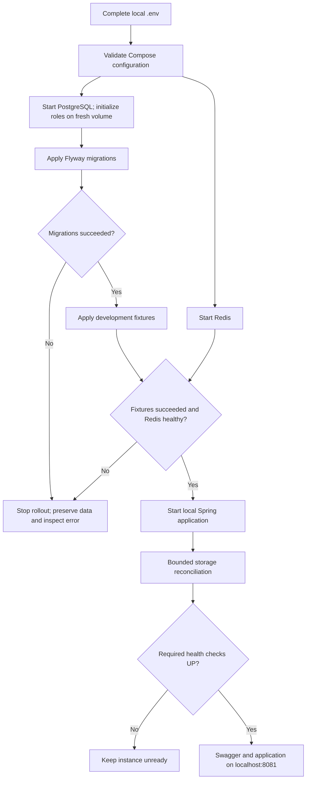

Sources: [docker-compose.yml](../docker-compose.yml), [docker-compose.local.yml](../docker-compose.local.yml), [postgresql-development-cutover.md](postgresql-development-cutover.md), [StorageReconciliationStartupGate.java](../src/main/java/auto/parto/config/StorageReconciliationStartupGate.java).

## HTTP authentication authorization and safe errors

**Status:** Implemented.

Public routes and protected routes have different authentication requirements. For protected operations, role checks and resource ownership are separate. Legacy aliases retain their endpoint rules; an alias does not grant additional access.

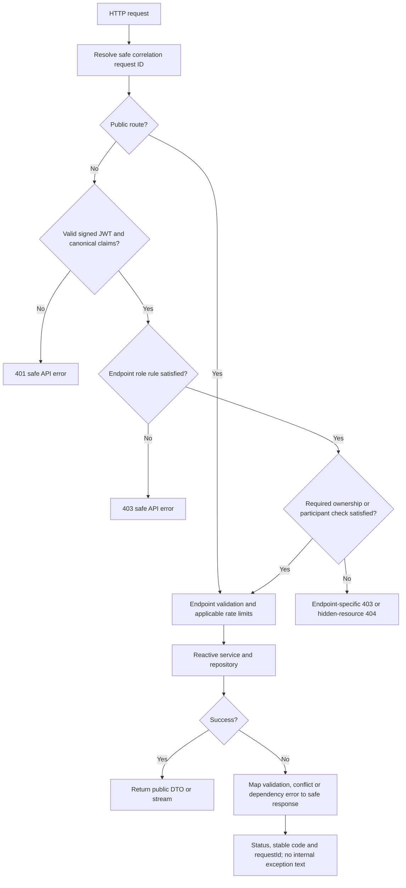

Sources: [JwtTokenAuthenticationFilter.java](../src/main/java/auto/parto/config/JwtTokenAuthenticationFilter.java), [CorrelationIdWebFilter.java](../src/main/java/auto/parto/config/CorrelationIdWebFilter.java), [authorization-conventions.md](authorization-conventions.md), [api-error-contract.md](api-error-contract.md).

## Redis authentication rate limiting

**Status:** Implemented for `/auth/` requests.

The filter resolves a client-IP key and uses the current Redis counter/window policy (five requests per minute). A missing Redis dependency or counter/expiry error rejects the authentication request with the same rate-limited response. The diagram describes the actual separate increment/first-count expiry calls, not an atomic Lua operation or an already completed production trusted-proxy rollout.

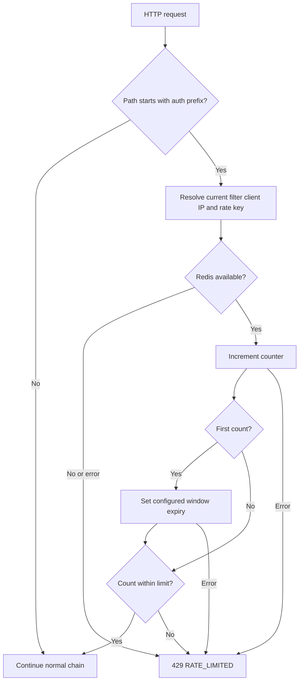

Sources: [RateLimitService.java](../src/main/java/auto/parto/service/RateLimitService.java), [RateLimitWebFilter.java](../src/main/java/auto/parto/config/filter/RateLimitWebFilter.java).

## OTP onboarding and login

**Status:** Implemented for enabled BUYER and SELLER strategies.

The challenge is persisted before the email is sent. Delivery failure therefore does not mean the identity/challenge transaction never happened. Public OTP does not provide an ADMIN issuance strategy.

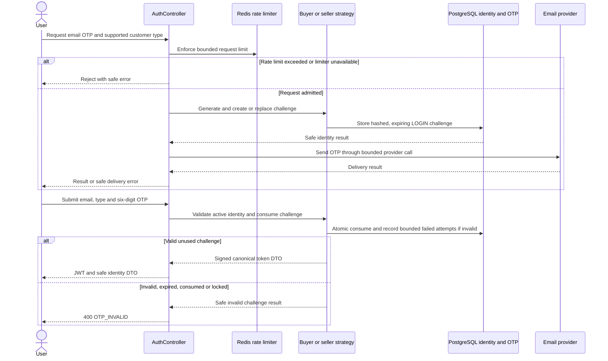

Sources: [AuthController.java](../src/main/java/auto/parto/api/AuthController.java), [BuyerIdentityStrategy.java](../src/main/java/auto/parto/service/BuyerIdentityStrategy.java), [SellerIdentityStrategy.java](../src/main/java/auto/parto/service/SellerIdentityStrategy.java), [canonical-authentication.md](canonical-authentication.md).

## JWT signing and key rotation

**Status:** Supported signing contract; rotation is an operator procedure.

Local/test profiles support HS256. The production profile requires RS256 and a verification-key set. The diagram describes the documented rotation order, not an automatic rotation job or an existing public ADMIN signup path.

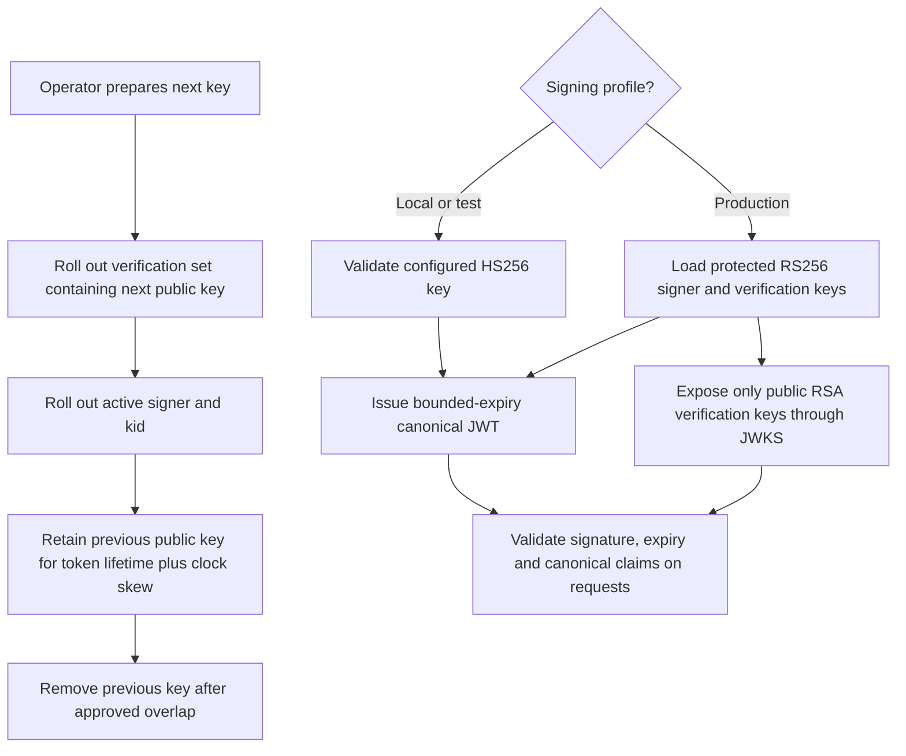

Sources: [JwtTokenGenerator.java](../src/main/java/auto/parto/utils/JwtTokenGenerator.java), [JwksController.java](../src/main/java/auto/parto/api/JwksController.java), [canonical-authentication.md](canonical-authentication.md), [production-secrets-runbook.md](production-secrets-runbook.md).

## Profile updates and account deactivation

**Status:** Implemented.

Buyer/seller profile updates derive the actor from the canonical principal. Self-deactivation follows its role and ownership checks and marks the account inactive; it is not a destructive database deletion or a claim of immediate revocation of every existing JWT.

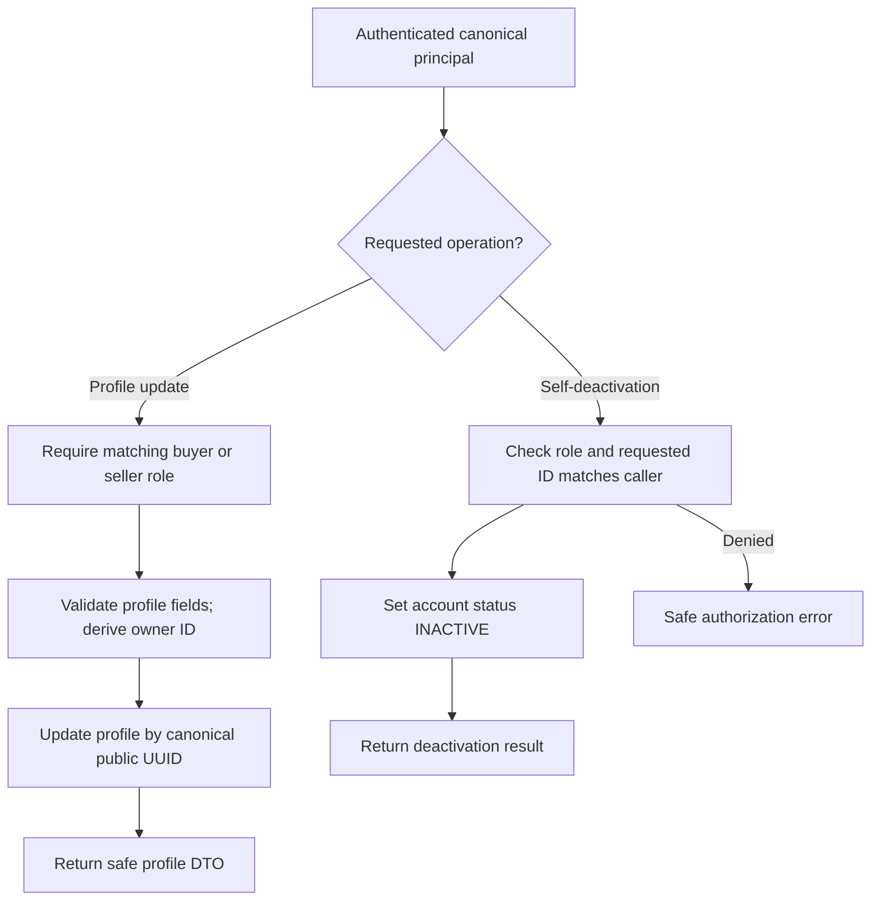

Sources: [BuyerProfileController.java](../src/main/java/auto/parto/api/BuyerProfileController.java), [SellerProfileController.java](../src/main/java/auto/parto/api/SellerProfileController.java), [BuyerController.java](../src/main/java/auto/parto/api/BuyerController.java), [SellerController.java](../src/main/java/auto/parto/api/SellerController.java), [BuyerService.java](../src/main/java/auto/parto/service/BuyerService.java), [SellerService.java](../src/main/java/auto/parto/service/SellerService.java).

## Buyer part request lifecycle

**Status:** Implemented when the PostgreSQL boundary is enabled.

Create and list operate on the authenticated buyer. Listing uses bounded keyset pagination. Close/cancel require ownership and OPEN status; guarded repository transitions reject concurrent changes.

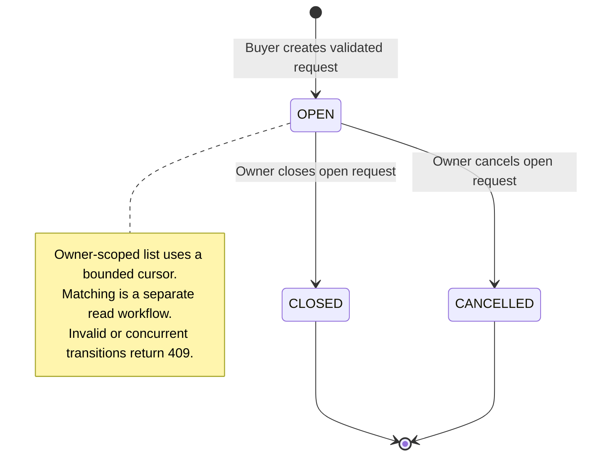

Sources: [PartRequestService.java](../src/main/java/auto/parto/service/PartRequestService.java), [api-part-requests.md](api-part-requests.md).

## Seller listing lifecycle

**Status:** Implemented when the PostgreSQL boundary is enabled.

New listings have DRAFT business status, NOT_READY delivery status and NOT_STORED storage status. Only the business lifecycle below is changed by the transition endpoint; delivery/storage states are independent. Ownership and expected-version checks apply.

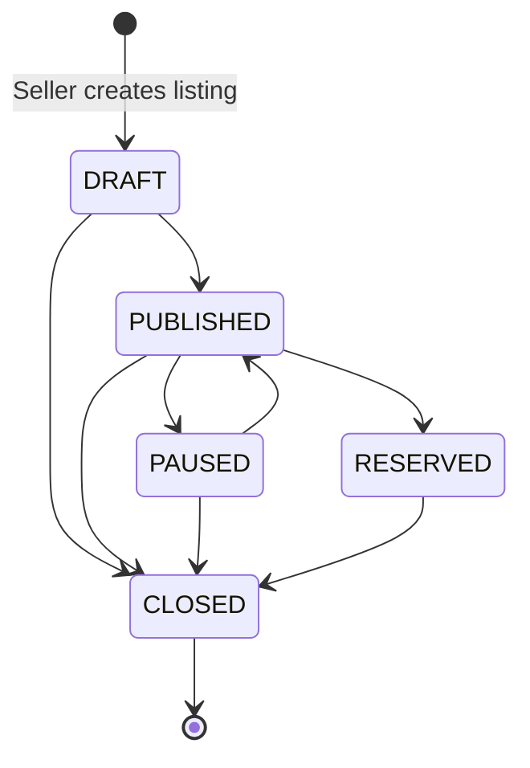

Sources: [PartListingService.java](../src/main/java/auto/parto/service/PartListingService.java), [api-part-listings.md](api-part-listings.md).

## Marketplace matching

**Status:** Implemented bounded read.

Matching finds published listings for an owned OPEN request. Supported exact filter shapes and limits are validated. This service does not send notifications or reserve stock.

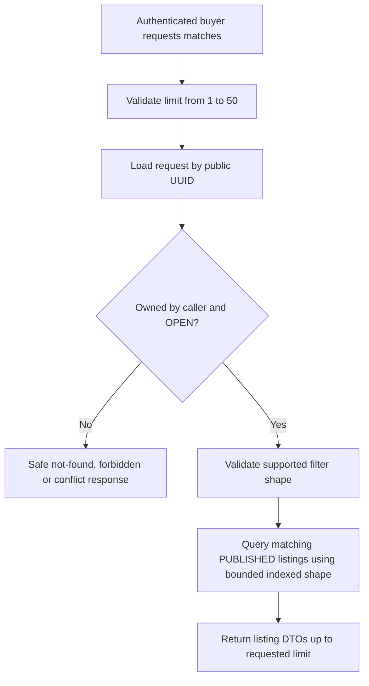

Sources: [MarketplaceMatchingService.java](../src/main/java/auto/parto/service/MarketplaceMatchingService.java), [api-part-requests.md](api-part-requests.md).

## Offer creation and decisions

**Status:** Implemented.

A seller can create an offer for a request; a buyer can create one for a listing. Reads/status updates require a participant. Only a seller participant accepts/rejects; either participant may cancel a pending offer. Expected-version checks reject races. Accepting an offer does not automatically transfer wallet funds or imply a listing transition.

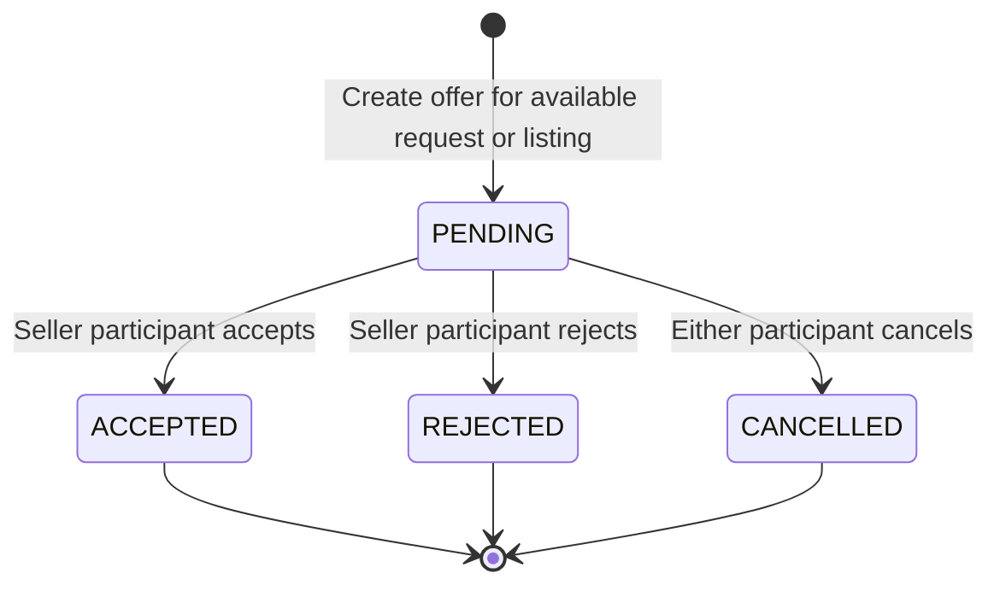

Sources: [PostgresqlOfferService.java](../src/main/java/auto/parto/service/PostgresqlOfferService.java), [R2dbcOfferRepository.java](../src/main/java/auto/parto/persistence/R2dbcOfferRepository.java).

## Wallet credit debit and idempotency

**Status:** Implemented PostgreSQL transaction.

Amounts use integer minor units plus currency. A live idempotency key is scoped to owner and operation and must match the request fingerprint. The ledger is immutable; replay does not append another entry. Retained keys expire after seven days under bounded cleanup.

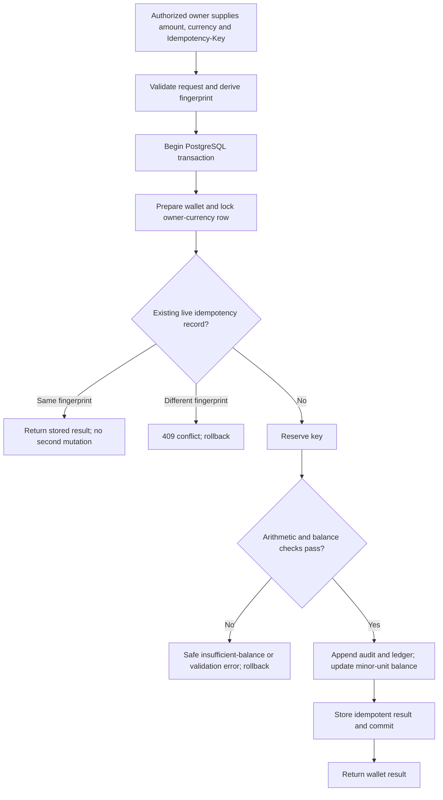

Sources: [R2dbcWalletRepository.java](../src/main/java/auto/parto/persistence/R2dbcWalletRepository.java), [wallet-ledger.md](wallet-ledger.md), [money.md](money.md).

## File upload and compensation

**Status:** Implemented.

The authenticated buyer/seller owns the upload target. PostgreSQL and object storage are not one atomic transaction. Pending metadata reserves quota, provider publication precedes guarded activation, and failures require compensation.

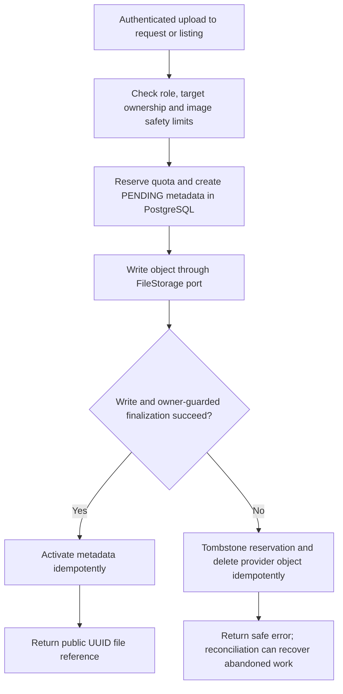

Sources: [FileManagerService.java](../src/main/java/auto/parto/service/FileManagerService.java), [R2dbcFileRepository.java](../src/main/java/auto/parto/persistence/R2dbcFileRepository.java), [file-storage.md](file-storage.md).

## File download

**Status:** Implemented.

The current GET file endpoint requires authentication and ACTIVE metadata, but does not enforce caller ownership or a buyer/seller role. Do not infer download policy from upload ownership checks.

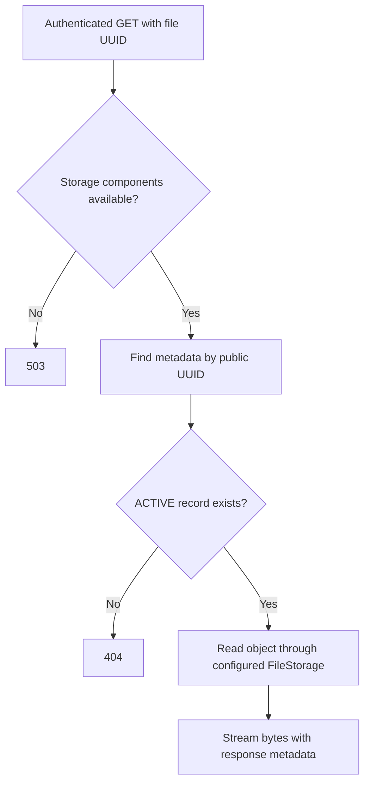

Sources: [ImageController.java](../src/main/java/auto/parto/api/ImageController.java), [file-storage.md](file-storage.md).

## Storage reconciliation and recovery

**Status:** Implemented when enabled.

The asynchronous startup gate stays unready until bounded reconciliation succeeds. Stale PENDING reservations are recovered with guarded state changes; active/missing/orphan checks remain bounded. Orphan cleanup is report-only unless explicitly enabled and is never performed on an incomplete scan. The current report retains orphan keys observed before deletion, so even successful cleanup needs a new clean reconciliation report; the startup listener itself runs once, not as an automatic recurring repair loop.

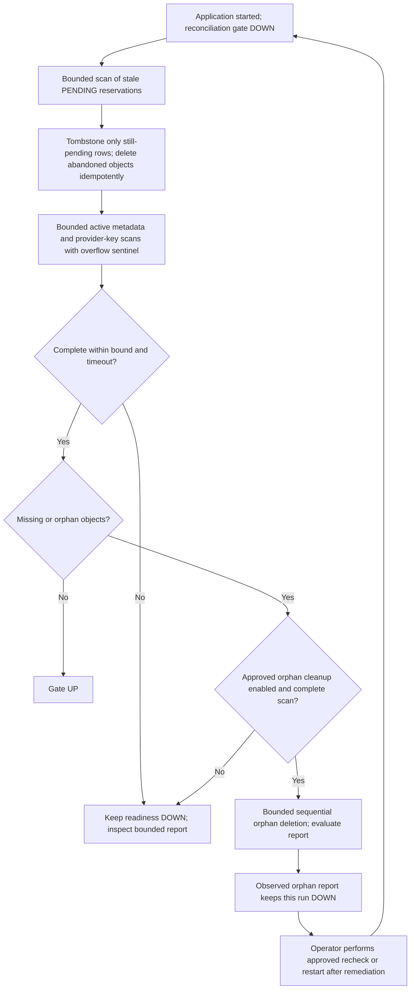

Sources: [StorageReconciliationService.java](../src/main/java/auto/parto/service/StorageReconciliationService.java), [StorageReconciliationStartupGate.java](../src/main/java/auto/parto/config/StorageReconciliationStartupGate.java), [file-storage.md](file-storage.md).

## Device token registration invalidation and rebuild

**Status:** Implemented when enabled.

PostgreSQL owns registrations and prevents cross-owner token reassignment. Redis is a bounded rebuildable delivery projection. Projection failure does not undo durable registration or invalidation.

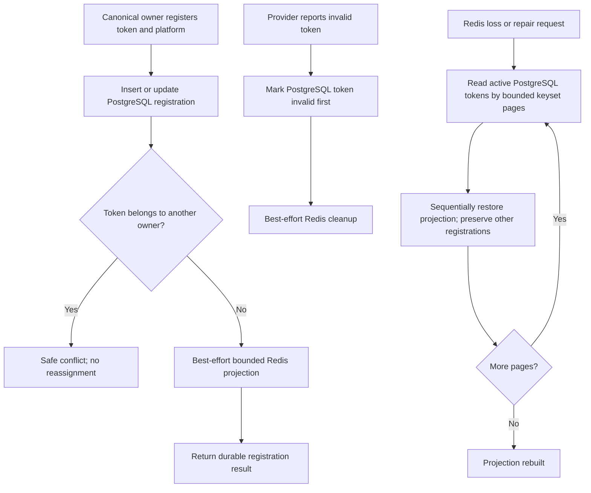

Sources: [DeviceTokenService.java](../src/main/java/auto/parto/service/notification/DeviceTokenService.java), [device-tokens.md](device-tokens.md).

## Notification preferences

**Status:** Implemented PostgreSQL preference APIs and query helpers.

Current reads and updates use the canonical public UUID directly; the compatibility email argument is ignored, and the current repository does not perform email-key migration. A missing full preference record returns DTO defaults (SMS and marketing disabled); the channel/type query helpers separately return `true` when no record exists. The filter helper is available but is not automatically enforced by every direct FCM/SSE delivery path.

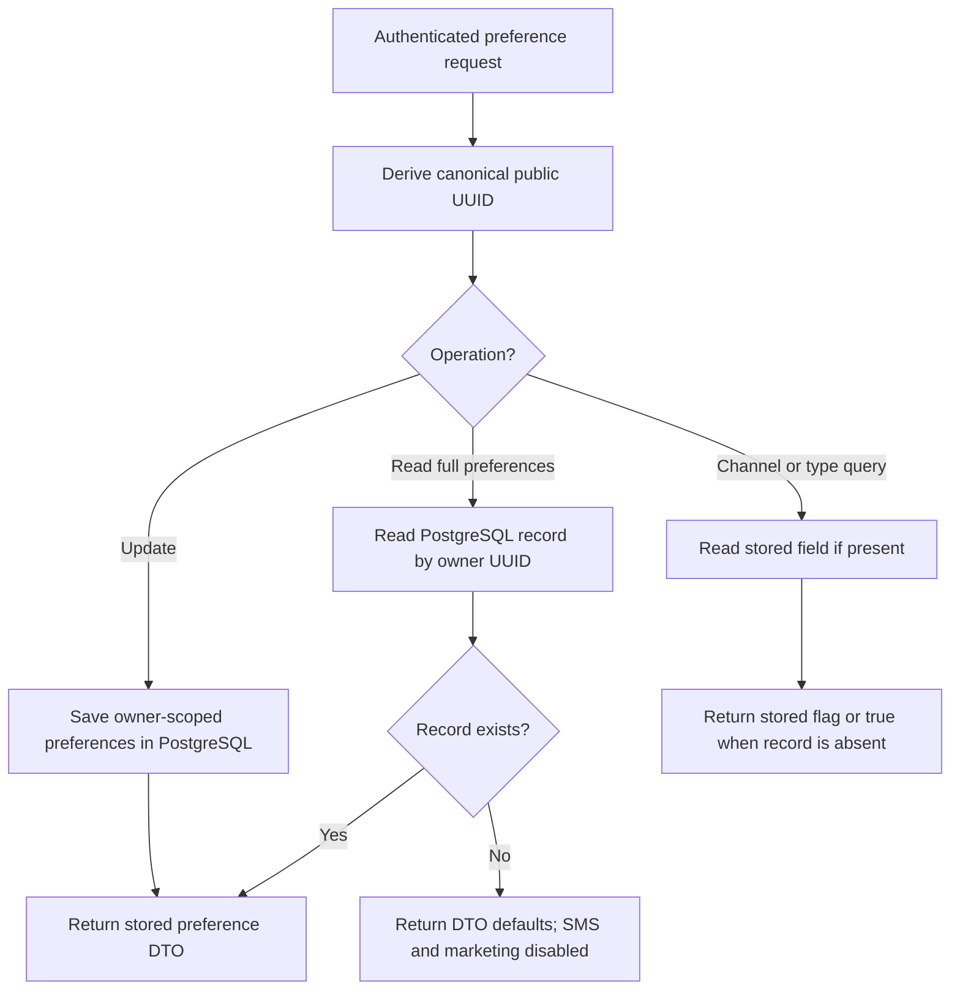

Sources: [NotificationPreferencesService.java](../src/main/java/auto/parto/service/NotificationPreferencesService.java), [R2dbcNotificationPreferencesRepository.java](../src/main/java/auto/parto/persistence/R2dbcNotificationPreferencesRepository.java), [NotificationPreferencesController.java](../src/main/java/auto/parto/api/NotificationPreferencesController.java), [NotificationPreferenceFilter.java](../src/main/java/auto/parto/service/notification/NotificationPreferenceFilter.java).

## Durable notification creation and SSE attempts

**Status:** Implemented when PostgreSQL notification persistence is enabled.

Persist notification intent before transport. Enqueue also creates its versioned event and AUDIT delivery row in the database transaction. SSE transport acknowledgement records a write attempt, not proof of client receipt. FCM is a separate explicitly invoked provider path, not an automatic fallback implied here.

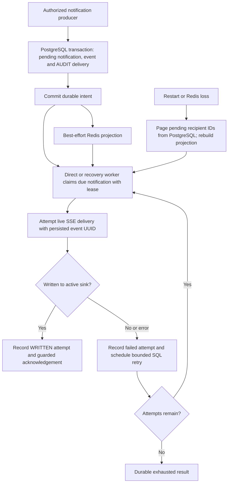

Sources: [HybridNotificationStore.java](../src/main/java/auto/parto/service/notification/HybridNotificationStore.java), [ResilientNotificationService.java](../src/main/java/auto/parto/service/notification/ResilientNotificationService.java), [ResilientPendingNotificationService.java](../src/main/java/auto/parto/service/notification/ResilientPendingNotificationService.java), [notifications-outbox.md](notifications-outbox.md).

## SSE connection replay and cleanup

**Status:** Implemented.

The current connection registry is process-local. Reconnect/replay uses the persisted notification UUID, not a request-payload ID. Live and replay can overlap, so clients deduplicate. Instance affinity is required by the current deployment contract; global live fan-out is not implemented by this registry.

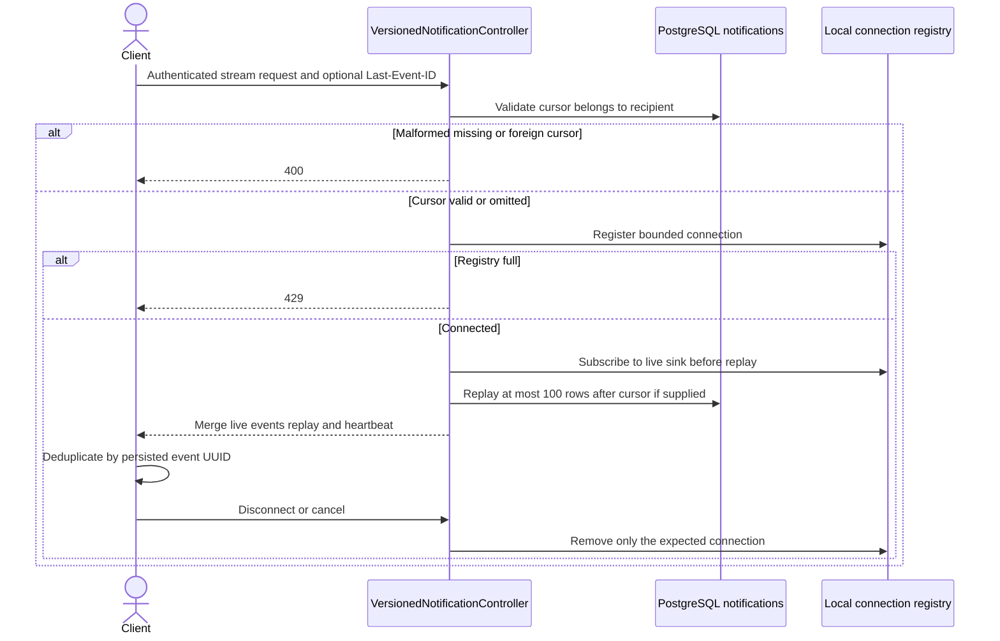

Sources: [VersionedNotificationController.java](../src/main/java/auto/parto/api/VersionedNotificationController.java), [SSENotificationService.java](../src/main/java/auto/parto/service/notification/SSENotificationService.java), [notifications-outbox.md](notifications-outbox.md).

## FCM provider delivery

**Status:** Implemented only when Firebase components are enabled.

Endpoint roles are checked by callers. Current direct FCM controller/service paths do not demonstrate universal preference enforcement; the preference API/filter is a separate workflow. Sends use bounded in-flight requests, batch concurrency, timeouts, retry filtering and a circuit breaker. Provider success is not device receipt; terminal failure is returned to the caller and does not by itself prove a durable FCM queue exists.

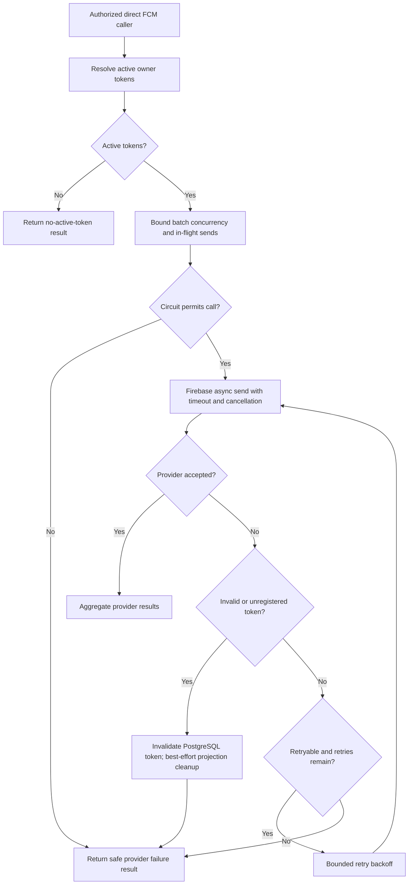

Sources: [FcmNotificationController.java](../src/main/java/auto/parto/api/FcmNotificationController.java), [ResilientFcmService.java](../src/main/java/auto/parto/service/notification/ResilientFcmService.java), [provider-isolation-runbook.md](provider-isolation-runbook.md).

## Audit outbox delivery

**Status:** Implemented only with separate audit-store configuration enabled.

The worker checks audit-store readiness before bounded operations. Claims use SKIP LOCKED and expiring leases. At-least-once delivery reuses a stable event UUID; the append-only audit store handles duplicates idempotently. No cross-worker global ordering is promised.

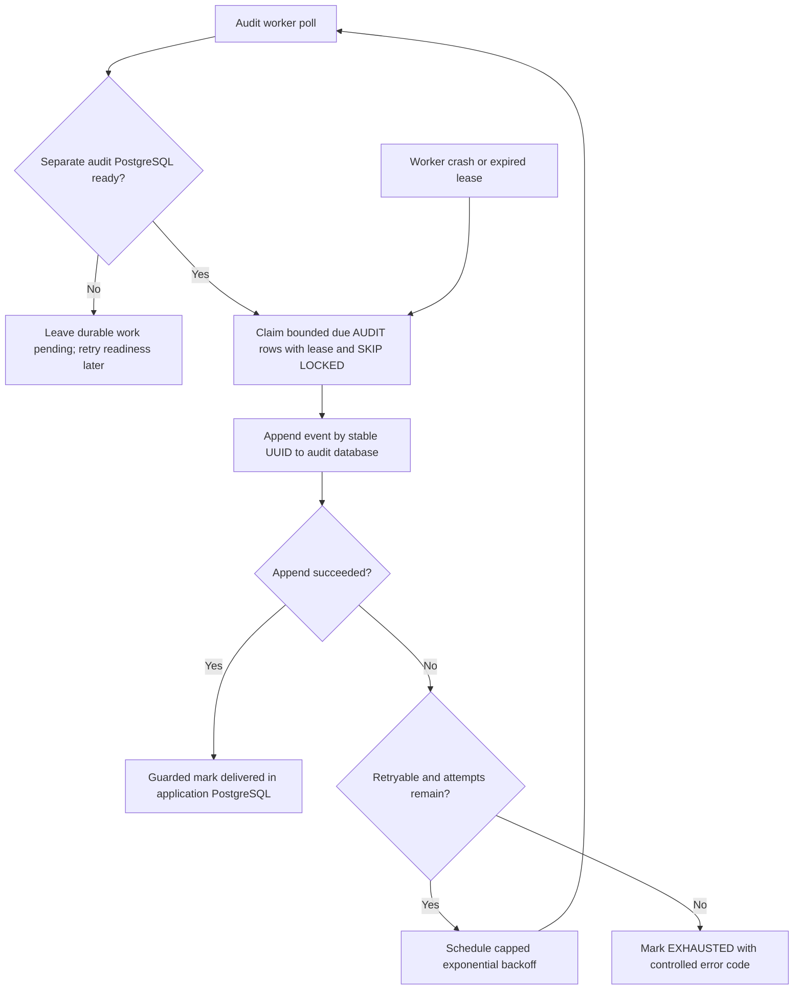

Sources: [AuditOutboxWorker.java](../src/main/java/auto/parto/audit/AuditOutboxWorker.java), [AuditPublisher.java](../src/main/java/auto/parto/audit/AuditPublisher.java), [R2dbcAuditOutboxRepository.java](../src/main/java/auto/parto/audit/R2dbcAuditOutboxRepository.java), [notifications-outbox.md](notifications-outbox.md).

## Audit replay reconciliation and retention

**Status:** Implemented when the audit boundary is enabled.

Replay requires authorized administrator access and reuses the original event identity. Reconciliation and cleanup run bounded batches; terminal-row retention does not mean deleting immutable historical audit events.

```mermaid
flowchart TD
    TASK{"Audit maintenance operation"} -->|Admin replay| AUTH["Authorize requester and original event"]
    AUTH --> LEASE["Claim delivery for replay or reject active claim"]
    LEASE --> APPEND["Idempotent append using original event UUID"]
    APPEND --> ACK["Mark delivery delivered"]
    TASK -->|Reconcile| FIND["Bounded scan of dispatched deliveries since cutoff"]
    FIND --> CHECK{"Audit store contains event?"}
    CHECK -->|Yes| KEEP["Keep delivery state"]
    CHECK -->|No| REPLAY["Mark delivery for replay"]
    TASK -->|Retention cleanup| PURGE["Bounded removal of eligible terminal delivery rows"]
    PURGE --> HISTORY["Historical audit events remain append-only"]
```

Sources: [AuditReplayController.java](../src/main/java/auto/parto/api/AuditReplayController.java), [AuditPublisher.java](../src/main/java/auto/parto/audit/AuditPublisher.java), [notifications-outbox.md](notifications-outbox.md).

## Provider isolation and cancellation

**Status:** Implemented adapters; enabled providers depend on configuration.

Email uses a bounded blocking scheduler, Firebase adapts an async future, and object storage uses an async client. Limits are provider-specific; the diagram does not imply every provider shares the same retry or circuit-breaker policy.

```mermaid
flowchart TD
    CALL["Application provider call"] --> ADAPTER{"Provider adapter"}
    ADAPTER -->|Email| EMAIL["Bounded scheduler threads and queue"]
    ADAPTER -->|Firebase| FCM["Bounded async in-flight send"]
    ADAPTER -->|S3 compatible| S3["Bounded async HTTP concurrency and acquisition"]
    EMAIL --> BOUND["Provider-specific deadline and cancellation"]
    FCM --> BOUND
    S3 --> BOUND
    BOUND --> OUTCOME{"Completion outcome"}
    OUTCOME -->|Success| VALUE["Return result"]
    OUTCOME -->|Timeout saturated cancelled failure| SAFE["Safe failure to caller policy"]
    OUTCOME --> METRIC["Low-cardinality provider telemetry; no payloads or credentials"]
```

Sources: [ProviderIsolationConfig.java](../src/main/java/auto/parto/config/ProviderIsolationConfig.java), [BoundedProviderScheduler.java](../src/main/java/auto/parto/config/BoundedProviderScheduler.java), [provider-isolation-runbook.md](provider-isolation-runbook.md).

## Current Swagger generation and browsing

**Status:** Current runtime; future admin-protected grouped design is not implemented here.

Springdoc serves the current controller contract and Swagger UI. Documentation paths are currently allowed without a bearer token; API calls still enforce their own endpoint rules. This is not a diagram of the future AP-0048 issuer/launcher/grouped-YAML implementation.

```mermaid
flowchart TD
    CODE["Mounted controllers DTOs and existing annotations"] --> DOC["Springdoc generates current OpenAPI document"]
    DOC --> JSON["v3 api-docs JSON"]
    BROWSER["Browser opens local Swagger UI"] --> CONFIG["Fetch Swagger configuration and current specification"]
    JSON --> CONFIG
    CONFIG --> VIEW["Browse operation list and schemas"]
    VIEW --> TRY["Try API operation"]
    TRY --> RULES["Normal endpoint authentication role and ownership rules apply"]
```

Sources: [SecurityConfig.java](../src/main/java/auto/parto/config/SecurityConfig.java), [JwtTokenAuthenticationFilter.java](../src/main/java/auto/parto/config/JwtTokenAuthenticationFilter.java), [pom.xml](../pom.xml), [api-boundaries.md](api-boundaries.md).

## Observability and incident diagnosis

**Status:** Implemented signals with operator diagnosis procedure.

Routing health is intentionally less detailed than private dependency diagnosis. Audit readiness gates audit processing separately; optional-provider problems do not automatically justify removing all application traffic. Production scrape/alert deployment still needs its documented staging proof.

```mermaid
flowchart TD
    REQUEST["Request or background operation"] --> SIGNAL["Request ID traces low-cardinality metrics and safe logs"]
    SIGNAL --> HEALTH{"Routing readiness UP?"}
    HEALTH -->|Yes| ROUTE["Continue normal traffic; inspect provider-specific failures separately"]
    HEALTH -->|No| LIVE{"Instance live?"}
    LIVE -->|No| PROCESS["Diagnose process or startup failure"]
    LIVE -->|Yes| DEPS["Inspect private PostgreSQL Redis pool and storage-reconciliation signals"]
    DEPS --> FIX["Repair dependency or approved configuration; preserve durable work"]
    PROCESS --> FIX
    FIX --> VERIFY["Recheck readiness before routing traffic"]
    SIGNAL --> AUDIT["Separate audit-store readiness controls audit worker"]
```

Sources: [observability-runbook.md](observability-runbook.md), [DomainMetrics.java](../src/main/java/auto/parto/config/DomainMetrics.java), [CorrelationIdWebFilter.java](../src/main/java/auto/parto/config/CorrelationIdWebFilter.java).

## GitHub continuous integration

**Status:** Implemented verification and packaging; no automatic deployment.

The workflow triggers on configured main/feat/fix/chore pushes and pull requests to main. Unit and integration jobs run after compilation, and packaging waits for both. Test reports are uploaded even when their job fails.

```mermaid
flowchart TD
    EVENT["Configured push or pull request to main"] --> BUILD["Java 21 clean compile"]
    BUILD --> UNIT["Clean unit tests"]
    BUILD --> VERIFY["Clean verify with Docker integration tests and coverage"]
    UNIT --> UREPORT["Upload Surefire reports even on failure"]
    VERIFY --> IREPORT["Upload Failsafe reports even on failure"]
    UNIT --> GATE{"Both jobs succeeded?"}
    VERIFY --> GATE
    GATE -->|No| STOP["Fix failure; packaging blocked"]
    GATE -->|Yes| PACKAGE["Clean package with tests skipped because gates already ran"]
    PACKAGE --> REVIEW["Reviewable result; no deployment job in this workflow"]
```

Sources: [ci.yml](../.github/workflows/ci.yml).

## Production secret delivery and activation

**Status:** Operator-controlled implemented playbook; staging proof still required.

This is the selected Ansible Vault procedure, not a claim of a ready production deployment. Vault unlock remains interactive on the authorized operator workstation. Each workload gets a distinct role-scoped bundle; migrations receive temporary credentials.

```mermaid
flowchart TD
    OP["Authorized operator and reviewed encrypted role bundle"] --> VERIFY["Verify host identity inventory role and protected secret roots"]
    VERIFY --> UNLOCK["Interactive Vault unlock on trusted workstation"]
    UNLOCK --> STAGE["Stage only target-role files with protected ownership and modes"]
    STAGE --> VALIDATE{"Bundle and generation validation pass?"}
    VALIDATE -->|No| FAIL["Keep previous generation; report redacted failure"]
    VALIDATE -->|Yes| ACTIVATE["Atomically activate validated generation"]
    ACTIVATE --> START["Start or verify intended service using read-only secret files"]
    START --> CHECK{"Service checks pass?"}
    CHECK -->|No| RECOVER["Use reviewed rollback or forward repair; keep traffic gated"]
    CHECK -->|Yes| PROOF["Record staging evidence without decrypted values"]
    PROOF --> CLEAN["Remove migration-only bundle after migration completes"]
```

Sources: [deploy-secret-bundles.yml](../deploy/ansible/deploy-secret-bundles.yml), [activate-secret-generation.sh](../deploy/ansible/activate-secret-generation.sh), [remove-migration-bundle.yml](../deploy/ansible/remove-migration-bundle.yml), [production-secrets-runbook.md](production-secrets-runbook.md).

## Protected migration and release gate

**Status:** Planned operator workflow in a separate controlled deployment repository.

The application repository does not contain this state-changing deployment job. The runbook requires an isolated deployment repository/runner, verified backup and immutable reviewed application revision before production migration or rollout.

```mermaid
flowchart TD
    OWNER["Authorized release operator"] --> SHA["Select immutable protected-main revision with passing CI"]
    SHA --> BACKUP["Verify backup restore evidence and protected environment attestation"]
    BACKUP --> ACCESS["Provision temporary least-privilege migration credentials"]
    ACCESS --> MIG["Apply reviewed Flyway migrations"]
    MIG --> GOOD{"Migration succeeded?"}
    GOOD -->|No| STOP["Stop rollout; preserve DB and history; forward repair"]
    GOOD -->|Yes| FIXTURE["Approved fixture and reconciliation preflight"]
    FIXTURE --> DEPLOY["Roll out compatible application artifact"]
    DEPLOY --> READY{"Readiness and release checks pass?"}
    READY -->|No| REPAIR["Approved compatible rollback or forward fix"]
    READY -->|Yes| TRAFFIC["Enable approved traffic path"]
    TRAFFIC --> CLEAN["Remove migration-only credentials and record evidence"]
```

Sources: [postgresql-development-cutover.md](postgresql-development-cutover.md), [production-secrets-runbook.md](production-secrets-runbook.md).

## Production edge and SSE release validation

**Status:** Target/operator procedure; network rollout and staging evidence remain gated.

Cloudflare and Nginx are the selected edge/origin boundary. Do not interpret the target deployment diagram as an already provisioned VPS environment or an application CI deploy job. Future protected Swagger must be validated at application level before its through-edge release check.

```mermaid
flowchart TD
    PROOF["Accepted application and dependency readiness proof"] --> EDGE["Configure approved Cloudflare to Nginx origin path"]
    EDGE --> TRUST["TLS trusted proxy addresses and restricted origin access"]
    TRUST --> HEALTH["Route only healthy application instances"]
    HEALTH --> SSE["Verify long-lived SSE timeouts reconnect and instance affinity"]
    SSE --> API["Verify auth uploads rate limits and applicable docs access through edge"]
    API --> DENY["Prove direct-origin bypass and spoofed forwarded headers are rejected"]
    DENY --> RELEASE{"Release evidence accepted?"}
    RELEASE -->|No| HOLD["Hold public release"]
    RELEASE -->|Yes| LIVE["Approved public traffic"]
```

Sources: [deployment-architecture.md](deployment-architecture.md), [observability-runbook.md](observability-runbook.md), [postgresql-redis-operations-runbook.md](postgresql-redis-operations-runbook.md).

## Backup restore and projection recovery

**Status:** Operator runbook; automated end-to-end recovery proof is not claimed.

A recovery plan must preserve consistency between authoritative PostgreSQL state and object storage. Redis projections are rebuildable, not the sole owner of business data. Replication does not replace off-cluster backups. Record drills before claiming a production recovery guarantee.

```mermaid
flowchart TD
    INCIDENT["Authorized restore or recovery operation"] --> HOLD["Gate affected traffic and verify selected backup"]
    HOLD --> SECRETS["Restore protected secret and encryption-key availability"]
    SECRETS --> DATA["Restore required PostgreSQL from verified backup"]
    DATA --> FILER["Restore object-store filer metadata"]
    FILER --> VOLUMES["Restore object volume data consistently"]
    VOLUMES --> IAM["Restore provider access policy and private routing"]
    IAM --> REDIS["Recover Redis service; rebuild durable projections from PostgreSQL"]
    REDIS --> RECON["Run bounded storage and durable-work reconciliation"]
    RECON --> READY{"Missing objects overflow or dependency failure?"}
    READY -->|Yes| STOP["Remain unready; repair and repeat approved checks"]
    READY -->|No| DRILL["Record reconciliation and readiness evidence"]
    DRILL --> TRAFFIC["Resume only approved healthy traffic"]
```

Sources: [file-storage.md](file-storage.md), [postgresql-redis-operations-runbook.md](postgresql-redis-operations-runbook.md), [production-secrets-runbook.md](production-secrets-runbook.md).

## Agent feature delivery and publication

**Status:** Agent instructions; not an executable enforcement service.

The coordinator tracks exact-candidate approvals. Coder owns implementation writes; Reviewer and DevOps inspect independently. A new candidate invalidates both approvals. Publication resolves the actual GitHub remote by all effective push URLs; missing setup or unavailable required evidence blocks that transition.

```mermaid
flowchart TD
    TASK["User-approved ticket and acceptance criteria"] --> PLAN["Coordinator checkpoints plan and assigns roles"]
    PLAN --> CODE["Coder implements tests docs and scoped commit"]
    CODE --> FREEZE["Freeze candidate SHA and record evidence"]
    FREEZE --> REVIEW["Reviewer checks correctness and security"]
    FREEZE --> OPS["DevOps checks build and operational readiness"]
    REVIEW --> BOTH{"Both approve same current SHA and checks pass?"}
    OPS --> BOTH
    BOTH -->|Changes requested| FIX["Coder repairs; new SHA invalidates approvals"]
    FIX --> ROUNDS{"Three unsuccessful repair rounds?"}
    ROUNDS -->|Yes| ESCALATE["Checkpoint and escalate unresolved findings to user"]
    ROUNDS -->|No| FREEZE
    BOTH -->|Blocked| WAIT["Checkpoint missing evidence; no publication"]
    BOTH -->|Yes| REMOTE["Select safe GitHub push URL destination and actual alias"]
    REMOTE --> SAFE{"Matching safe remote and tools available?"}
    SAFE -->|No| WAIT
    SAFE -->|Yes| PUSH["Push approved SHA to explicit feature branch and open PR"]
    PUSH --> CI{"Required CI result on PR head?"}
    CI -->|Failed| FIX
    CI -->|Pending| PENDING["Wait for meaningful CI result"]
    PENDING --> CI
    CI -->|Unavailable| WAIT
    CI -->|Passed| HUMAN["Notify user with PR for final GitHub review"]
```

Sources: [agent-workflow.md](agent-workflow.md), [coder.toml](../.codex/agents/coder.toml), [reviewer.toml](../.codex/agents/reviewer.toml), [devops.toml](../.codex/agents/devops.toml).

## Creative proposals and human approval

**Status:** Agent discovery protocol; implementation requires explicit user approval.

Coder may record evidence-based product, technical or workflow improvements. No proposal is required without a worthwhile opportunity. Reviewer/DevOps recommendations are advisory; they are not a user decision or permission to implement. Optional proposals cannot block approved work or mutate a frozen candidate.

```mermaid
stateDiagram-v2
    [*] --> Draft: Evidence-based opportunity
    Draft --> UnderReview: Coder transfers write ownership to coordinator
    UnderReview --> Draft: Revise with explicit ownership transfer
    UnderReview --> AwaitingDecision: Independent peer assessments recorded
    AwaitingDecision --> Approved: Explicit user approval and scope
    AwaitingDecision --> Deferred: User defers
    AwaitingDecision --> Rejected: User rejects
    Deferred --> Draft: Reconsider with recorded reason
    Rejected --> Draft: Reconsider with recorded reason
    Approved --> Tickets: Create approved-scope backlog tickets
    Approved --> Draft: Material scope change needs reapproval
    Tickets --> [*]
```

Sources: [agent-workflow.md](agent-workflow.md), [README.md](feature-proposals/README.md), [TEMPLATE.md](feature-proposals/TEMPLATE.md).

## Context handover and task recovery

**Status:** Agent continuity protocol.

The coordinator updates ignored handover.md at milestones and before context pressure or ownership transfer. Recovery verifies live state rather than trusting stale prose. The file is checkout-local and must be explicitly transferred when changing worktrees or machines.

```mermaid
flowchart TD
    MILESTONE["Milestone context pressure pause or owner transfer"] --> COLLECT["Collect role checkpoints and exact branch-SHA evidence"]
    COLLECT --> WRITE["Coordinator atomically updates local handover.md"]
    WRITE --> NEXT["Next agent reads guide and handover"]
    NEXT --> VERIFY["Verify actual Git state remotes PR checks and evidence"]
    VERIFY --> MATCH{"Snapshot still matches?"}
    MATCH -->|No| INVALIDATE["Reconcile changes and invalidate stale approvals"]
    MATCH -->|Yes| RESUME["Resume first unfinished action with named owner"]
    INVALIDATE --> RESUME
    ABSENT["Missing checkpoint or another checkout"] --> REBUILD["Transfer sanitized checkpoint or reconstruct from evidence"]
    REBUILD --> VERIFY
```

Sources: [agent-workflow.md](agent-workflow.md), [agent-handover-template.md](agent-handover-template.md).
