# Functional Workflows

These diagrams explain what buyers, sellers and members can do, the decisions they make, and the resulting business outcomes. They describe backend capabilities; they do not imply that a particular screen or mobile application has been built. Availability depends on the enabled features and account permissions.

Start with a journey below. Each diagram covers one user goal. The [technical workflow reference](technical-workflows.md) contains implementation and operations details.

## Journey index

- [Join or sign in](#join-or-sign-in)
- [Manage a profile or deactivate an account](#manage-a-profile-or-deactivate-an-account)
- [Request a car part](#request-a-car-part)
- [Publish and manage a listing](#publish-and-manage-a-listing)
- [Find parts matching a request](#find-parts-matching-a-request)
- [Make and decide on an offer](#make-and-decide-on-an-offer)
- [View or change a wallet balance](#view-or-change-a-wallet-balance)
- [Attach photos to a request or listing](#attach-photos-to-a-request-or-listing)
- [View an uploaded image](#view-an-uploaded-image)
- [Choose notification preferences](#choose-notification-preferences)
- [Receive account notifications](#receive-account-notifications)
- [Enable push notifications on a device](#enable-push-notifications-on-a-device)

## Join or sign in

A buyer or seller accesses their account.

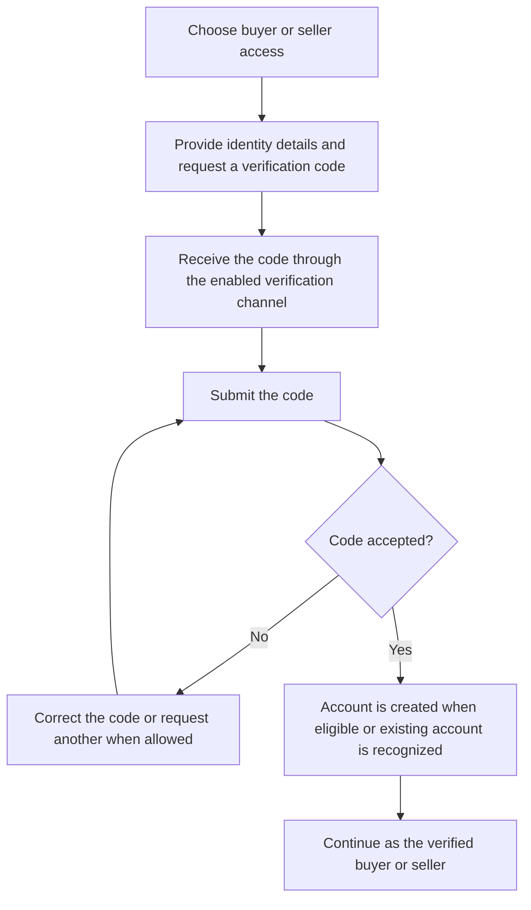

Public onboarding supports buyers and sellers. Administrator access follows a separate controlled process. Repeated attempts can be temporarily limited.

Business rules and implementation reference: [supporting documentation](canonical-authentication.md).

## Manage a profile or deactivate an account

A member maintains their own account information.

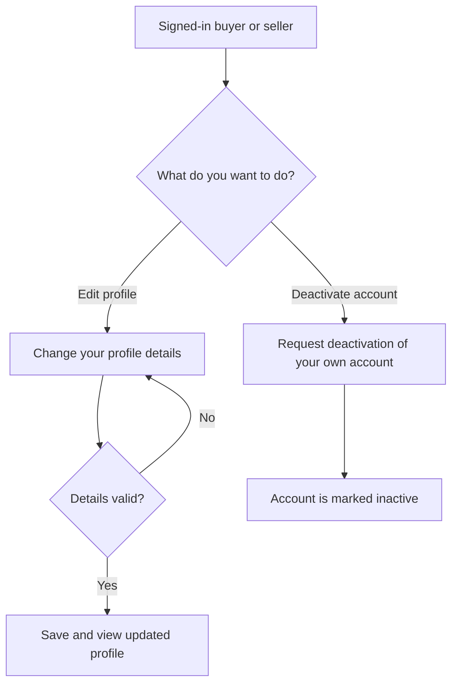

Deactivation marks the account inactive. It does not promise immediate termination of every existing signed-in session.

Business rules and implementation reference: [supporting documentation](canonical-authentication.md).

## Request a car part

A buyer describes a needed part and manages the request.

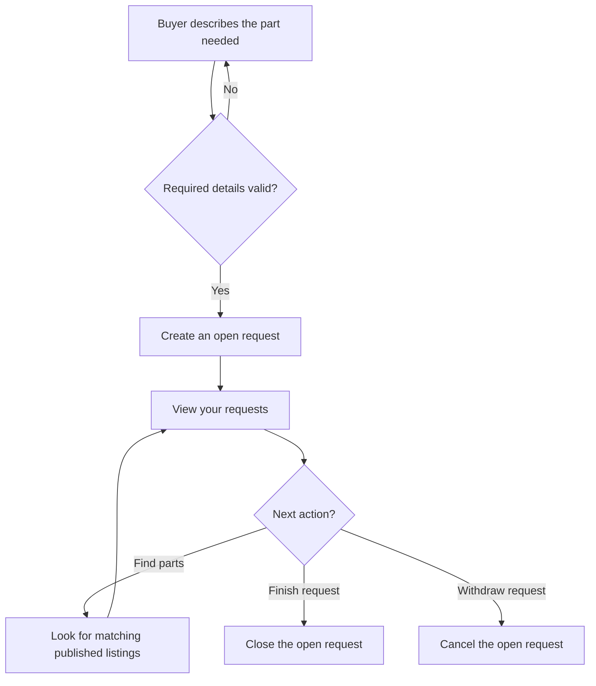

Only the owner closes or cancels an open request. Closing does not establish that payment or delivery occurred.

Business rules and implementation reference: [supporting documentation](api-part-requests.md).

## Publish and manage a listing

A seller controls when their part is available.

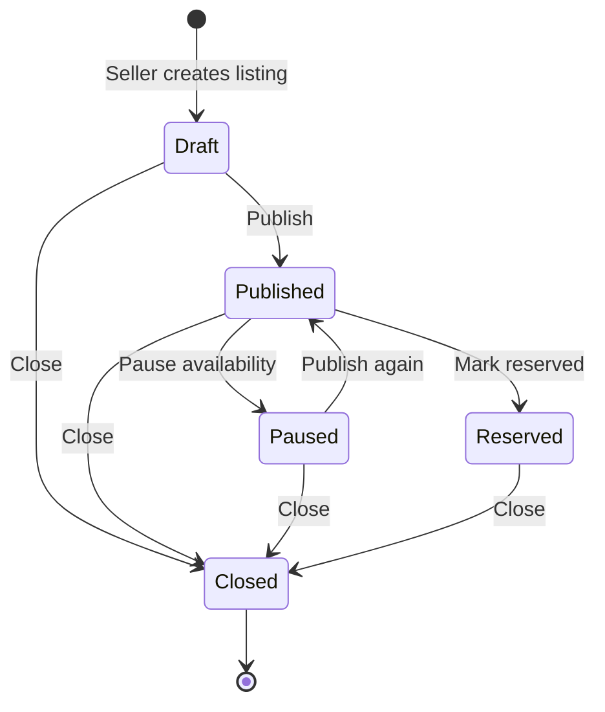

The seller manages their own listing. Reservation is a listing decision; accepting an offer does not automatically reserve it. Delivery progress is separate.

Business rules and implementation reference: [supporting documentation](api-part-listings.md).

## Find parts matching a request

A buyer discovers available parts for an open request.

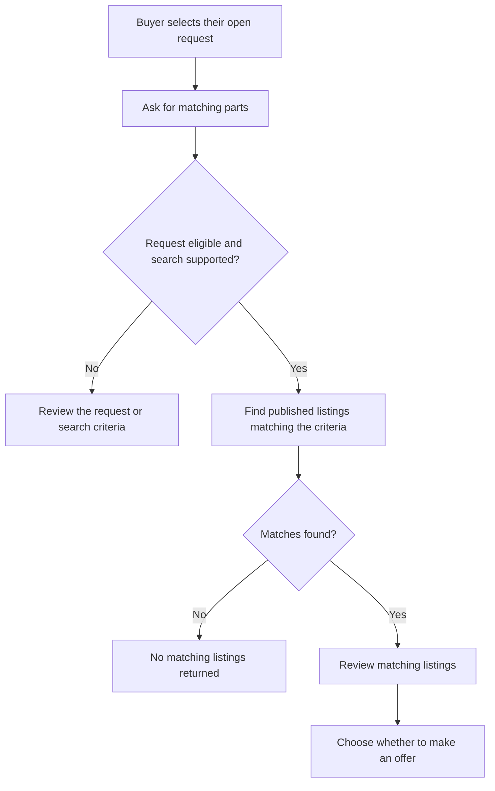

Searching does not reserve a part or automatically notify sellers. A request must belong to the buyer and remain open.

Business rules and implementation reference: [supporting documentation](api-part-requests.md).

## Make and decide on an offer

A buyer and seller express and decide on an offer.

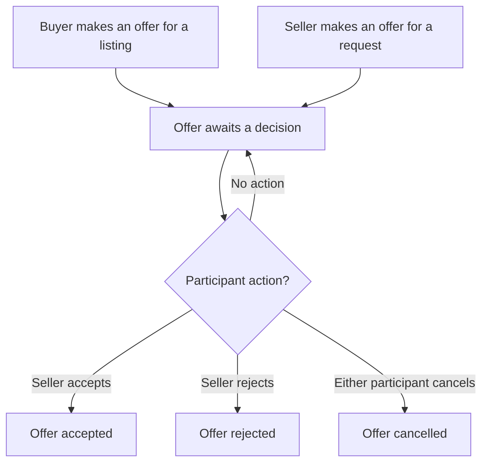

Current rules give acceptance and rejection to the seller participant, including when the seller created the offer. Either participant may cancel a pending offer. Acceptance records the decision; payment, reservation and delivery are separate.

Business rules and implementation reference: [supporting documentation](technical-workflows.md#offer-creation-and-decisions).

## View or change a wallet balance

An authorized account holder views or requests a change to their wallet.

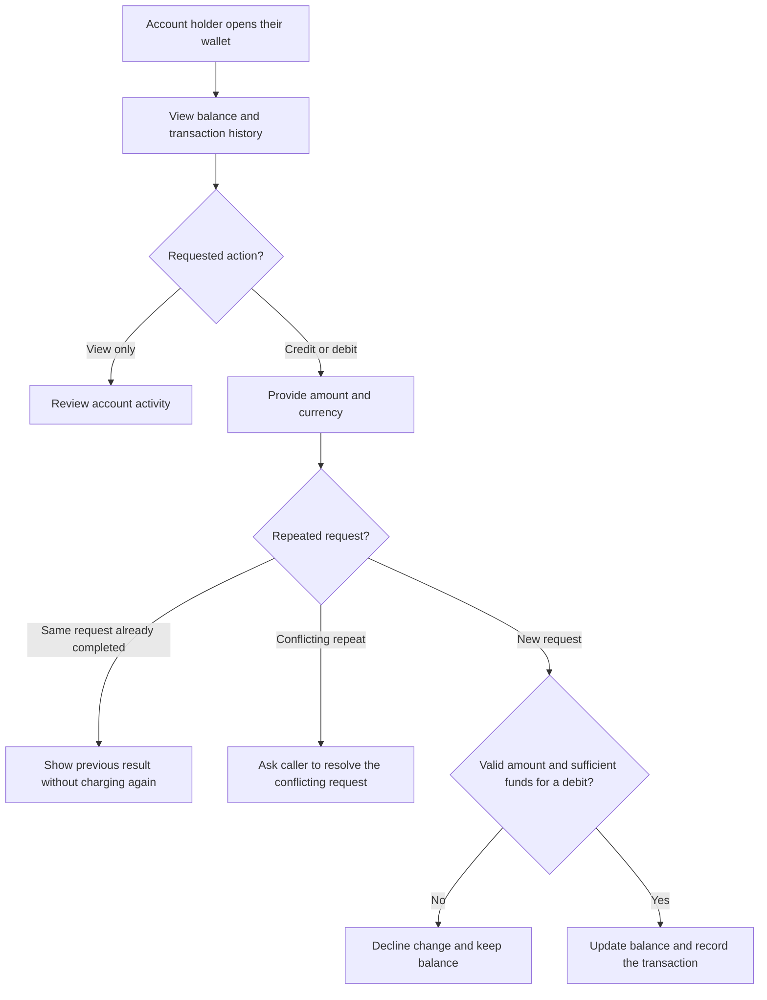

Wallet credits and debits are account operations. A credit is not proof of an external payment, and offer acceptance does not automatically move money. Repeat protection applies while the request reference is retained.

Business rules and implementation reference: [supporting documentation](wallet-ledger.md).

## Attach photos to a request or listing

A buyer or seller adds a supported image to their own marketplace item.

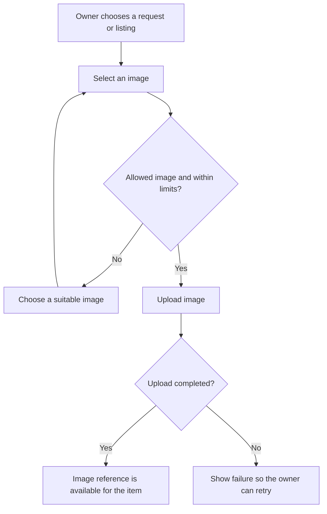

Uploads require ownership of the target. Failed or unfinished uploads must not be presented as completed attachments.

Business rules and implementation reference: [supporting documentation](file-storage.md).

## View an uploaded image

A signed-in member retrieves an available image.

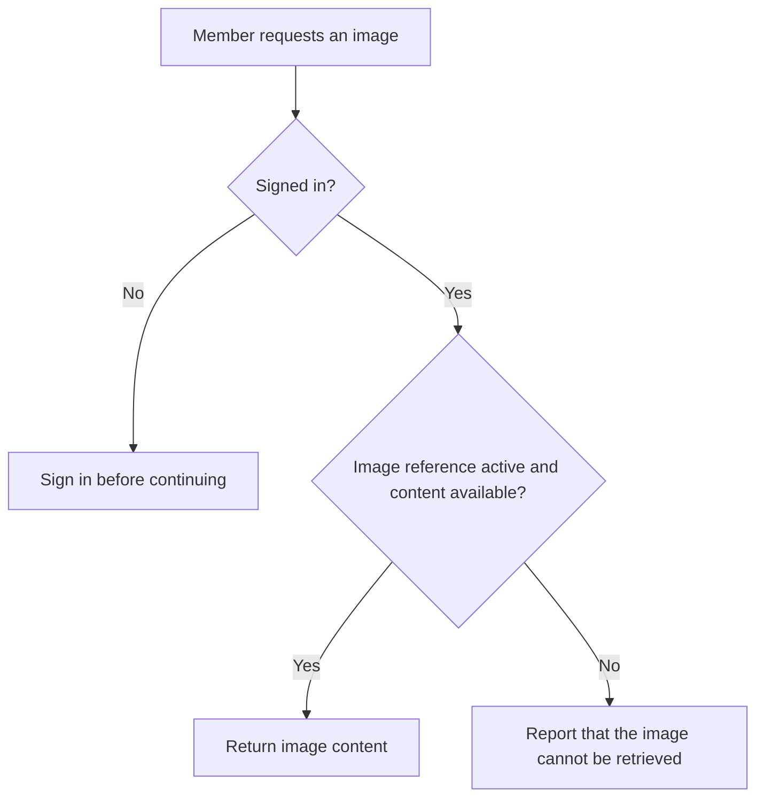

Current image retrieval requires sign-in, but does not restrict retrieval to the uploader. This documents the existing access policy.

Business rules and implementation reference: [supporting documentation](file-storage.md).

## Choose notification preferences

A member saves their notification choices.

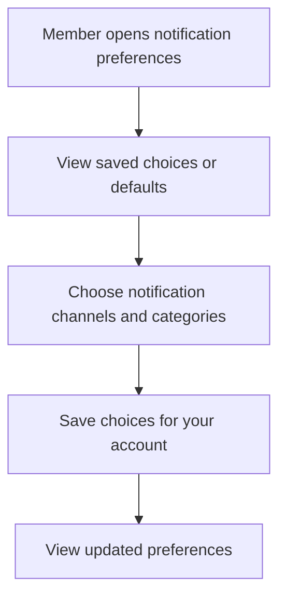

Saving preferences is supported. Preference enforcement is incomplete across delivery paths, so these choices are not currently a universal guarantee that messages will be suppressed.

Business rules and implementation reference: [supporting documentation](technical-workflows.md#notification-preferences).

## Receive account notifications

A member receives updates when the relevant notification features are enabled.

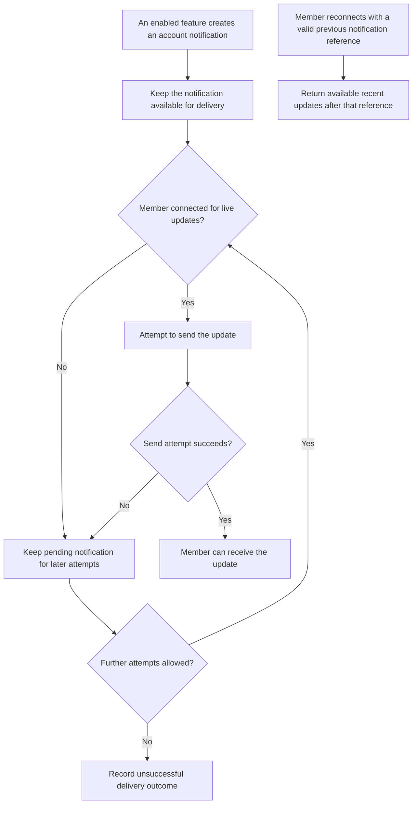

A successful send does not prove the member read the message. Catch-up is limited; it is not an unlimited notification history. Marketplace matching and offer actions are not assumed to create notifications automatically.

Business rules and implementation reference: [supporting documentation](notifications-outbox.md).

## Enable push notifications on a device

A member registers a device for supported push updates.

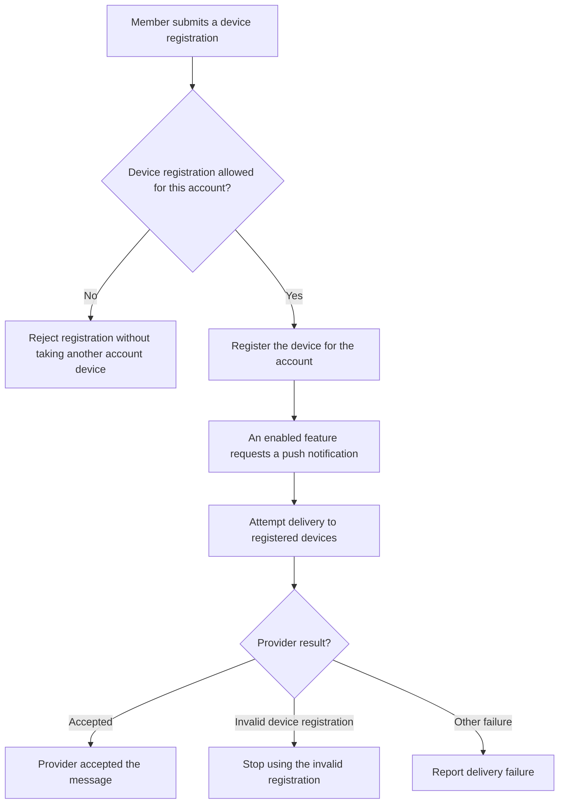

Push availability depends on configuration and the device application. Provider acceptance does not prove display or reading. Push is a separate delivery path; automatic fallback from account notifications is not assumed.

Business rules and implementation reference: [supporting documentation](device-tokens.md).
